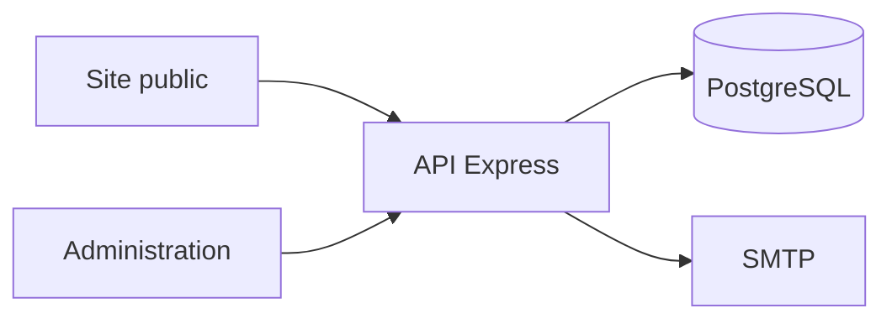

# Alexandre Bindl

Site de la **galerie** de l'artiste peintre Alexandre Bindl : œuvres, exposition, contact et administration.

<p align="center">
  
  
  
  
  
</p>

<p align="center">
  <strong>Dépôt :</strong> <a href="https://github.com/Meriem1403/PeintreAB">github.com/Meriem1403/PeintreAB</a>
</p>

---

## Sommaire

- [Présentation](#présentation)
- [Fonctionnalités](#fonctionnalités)
- [Stack technique](#stack-technique)
- [Architecture](#architecture)
- [Prérequis](#prérequis)
- [Installation](#installation)
- [Variables d'environnement](#variables-denvironnement)
- [Déploiement](#déploiement)
- [Sécurité](#sécurité)
- [Structure du projet](#structure-du-projet)
- [Documentation](#documentation)
- [Scripts disponibles](#scripts-disponibles)

---

## Présentation

Le site public présente l'artiste, la galerie et les œuvres. L'administration, derrière une connexion, gère les tableaux, les événements, les catégories, le thème, les messages et les statistiques. Deux habillages de page d'accueil et de galerie se choisissent par variable d'environnement, sans changer le code.

---

## Fonctionnalités

| Espace | Contenu |
|--------|---------|
| **Accueil** | Variantes atelier ou classique |
| **Galerie** | Grille éditoriale ou classique, fiche œuvre |
| **Biographie** | Présentation de l'artiste |
| **Contact** | Formulaire et coordonnées |
| **Pages légales** | Confidentialité |
| **Administration** | Œuvres, événements, catégories, thème, SMTP, analytics |
| **Comptes admin** | Connexion, mot de passe oublié, second compte possible |

---

## Stack technique

| Couche | Technologies |
|--------|----------------|
| Frontend | React, Vite, React Router |
| API | Node.js, Express |
| Données | PostgreSQL |
| Courriel | SMTP (Mailpit en local) |
| Conteneurisation | Docker Compose |
| Cibles | Compose local, production, NAS Synology |

---

## Architecture



---

## Prérequis

- **Docker** et Docker Compose
- **Node.js** pour un lancement du frontend hors Docker
- **Git**

---

## Installation

```bash
git clone https://github.com/Meriem1403/PeintreAB.git
cd PeintreAB
cp backend/.env.example backend/.env
cp .env.example .env
docker compose up --build
```

| Service | URL locale |
|---------|------------|
| Site | http://localhost:5173 |
| API | http://localhost:3000 |
| PostgreSQL | `localhost:5432` |
| Mailpit | http://localhost:8025 |

Au premier lancement, choisir les mots de passe admin et de base dans `backend/.env`, puis les changer. Aucun mot de passe par défaut n'est publié dans ce dépôt.

Le pas à pas court est dans [QUICK_START.md](./QUICK_START.md).

---

## Variables d'environnement

Frontend (`.env`) :

| Variable | Rôle |
|----------|------|
| `VITE_HOME_VARIANT` | Habillage de l'accueil |
| `VITE_GALLERY_VARIANT` | Habillage de la galerie |

API (`backend/.env`) :

| Variable | Rôle |
|----------|------|
| `DB_HOST`, `DB_PORT`, `DB_NAME`, `DB_USER`, `DB_PASSWORD`, `DB_SSL` | PostgreSQL |
| `JWT_SECRET`, `JWT_EXPIRES_IN` | Session admin |
| `ADMIN_EMAIL`, `ADMIN_PASSWORD` | Premier compte, à choisir puis à changer |
| `ADMIN_EMAIL_2`, `ADMIN_PASSWORD_2` | Second compte, optionnel |
| `FRONTEND_URL` | Origine autorisée |
| `EMAIL_HOST`, `EMAIL_PORT`, `EMAIL_USER` | SMTP réel, hors développement |

---

## Déploiement

| Cible | Fichiers |
|-------|----------|
| Local | `docker-compose.yml` |
| Production | `docker-compose.prod.yml`, `deploy.sh` |
| NAS Synology | `docker-compose.nas.yml`, `deploy-nas.sh`, [README_NAS_DEPLOYMENT.md](./README_NAS_DEPLOYMENT.md) |
| Transfert de données | `export-data.ps1`, `import-data.ps1`, [README_DATA_TRANSFER.md](./README_DATA_TRANSFER.md) |

---

## Sécurité

- Mots de passe admin et JWT uniquement dans `backend/.env`.
- Si un mot de passe de démonstration a un jour été utilisé en ligne, le changer sur l'instance : le dépôt ne le contient plus.
- SMTP de production distinct de Mailpit.
- Uploads d'œuvres servis par l'API, pas en clair dans Git.

---

## Structure du projet

```
PeintreAB/
├── src/pages/                     # Site public et admin
├── backend/src/routes/            # Œuvres, événements, contact, auth
├── docker-compose.yml
├── docker-compose.prod.yml
├── docker-compose.nas.yml
└── scripts/
```

---

## Documentation

| Document | Contenu |
|----------|---------|
| [QUICK_START.md](./QUICK_START.md) | Premier lancement |
| [README_DEPLOYMENT.md](./README_DEPLOYMENT.md) | Mise en production |
| [README_NAS_DEPLOYMENT.md](./README_NAS_DEPLOYMENT.md) | NAS Synology |
| [README_EMAIL_SETUP.md](./README_EMAIL_SETUP.md) | SMTP |
| [README_SEO.md](./README_SEO.md) | Référencement |
| [README_DATA_TRANSFER.md](./README_DATA_TRANSFER.md) | Export et import |
| [README_WINDOWS.md](./README_WINDOWS.md) | Poste Windows |
| [README_BROWSER_COMPATIBILITY.md](./README_BROWSER_COMPATIBILITY.md) | Navigateurs |

---

## Scripts disponibles

| Commande | Description |
|----------|-------------|
| `npm run dev` | Vite |
| `npm run build` | Build de production |
| `npm run preview` | Prévisualisation |
| `npm run lint` | ESLint |
| `docker compose up --build` | Pile complète |

---

<p align="center">
  <sub>Galerie Alexandre Bindl — site public et administration. Aucun mot de passe par défaut dans le dépôt.</sub>
</p>
